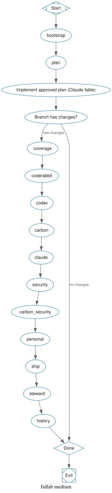
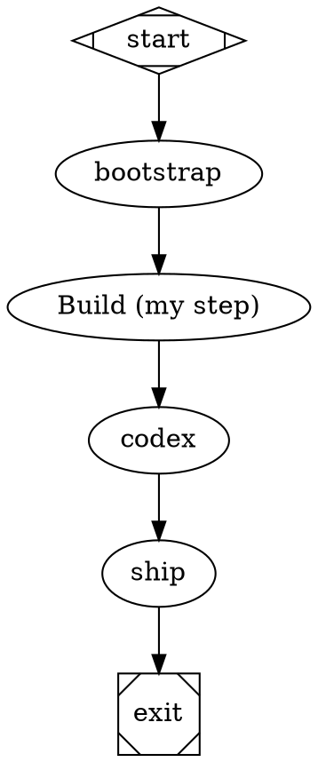

# fidfab

**The enlightened computational science factory for expert research software engineers.**

fidfab is a set of [Fabro](https://fabro.sh) workflows, reusable workflow components, and a
locally built Docker sandbox for human-driven, aligned agentic development of scientific
software. It emphasizes **understanding** (plans and roadmaps you read and approve before code
is written), **verification** (coverage checks, multiple independent reviews, security and
personal-data audits, CI stewardship), and **reproducibility** (a pinned Ubuntu 26.04 image,
pixi and Rust toolchains, every step recorded in the Fabro run log).

Everything runs on your workstation: a local Fabro server, local Docker containers, and
leading models through your own Claude Code and Codex subscriptions over the
[Agent Client Protocol](https://agentclientprotocol.com) (ACP). Fabro-native steps default to
Gemini 3.8 Flash on Google Cloud Vertex AI, reached through a local LiteLLM proxy, and Gemini 4
Carbon adds independent code and security reviews. The compute-heavy work (compilation, tests)
uses the full local machine.

<p align="center">
  
</p>

- [How it fits together](#how-it-fits-together)
- [Workflows](#workflows)
- [Setup](#setup)
- [Running workflows](#running-workflows)
- [Using fidfab from another repository](#using-fidfab-from-another-repository)
- [VS Code](#vs-code)
- [Tests](#tests)
- [Repository layout](#repository-layout)
- [Known limitations](#known-limitations)
- [License](#license)

## How it fits together

```
 you ──(fabro run / web UI / VS Code)──▶ local Fabro server ──▶ LiteLLM proxy (127.0.0.1:4000)
                                           │                       └─▶ Vertex AI: Gemini 3.8 Flash,
                                           │                           Gemini 4 Carbon
                                           │  injects vault secrets, mints a scoped GITHUB_TOKEN
                                           ▼
                                   docker: fidfab:latest  (Ubuntu 26.04)
                                   ├── /workspace   clone of the target branch
                                   ├── claude-agent-acp ──▶ Claude Code (fable / opus)   subscription
                                   ├── codex-acp ────────▶ Codex (terra)                 subscription
                                   ├── coderabbit --agent
                                   ├── pixi, rust, vite+, serena, cocoindex-code, gh
                                   └── fidfab-* helpers (bootstrap, diff, pr-status, …)
```

1. You start a run with a goal (`--goal "…"` or `--goal-file task.md`). For `medium` and
   `large`, a Claude Code (fable) session first produces planning documents and pauses at a
   human gate; you approve or type feedback, as many rounds as needed.
2. Claude Code implements the approved plan in the sandbox.
3. The verification pipeline runs over the diff: coverage of uncovered behaviour (opus),
   CodeRabbit review and autonomous fix (opus, with a 3-minute retry and a fallback to Claude's
   built-in review), Codex (terra) review, Gemini 4 Carbon review, Claude (fable) review, a
   security review, a second Gemini 4 Carbon security review, a personal-data decision with an optional Cloudflare security audit, each followed by an
   opus "verify and address" pass that writes a Markdown record of the approach taken per finding.
4. opus writes the commit, opens the PR with `gh pr create --fill`, then rewrites the title and
   body from the actual diff and task context.
5. A steward loop (opus) addresses review threads, rebases on conflicts, fixes failing CI, then
   waits an hour and repeats until the PR is quiet and green. By default you screen each round
   of review comments before an agent reads them and approve the replies before they are posted
   ([Review comments are untrusted](#review-comments-are-untrusted)).
6. When the steward leaves the PR green and quiet, opus rewrites the branch's commits (Fabro's
   per-stage checkpoints and the fixes made along the way) into logically related commits with
   meaningful messages, without changing the code, and force-pushes the pull request branch
   ([Commit history](#commit-history)).

The models, effort levels, and tools for each step are declared in the DOT graphs under
`.fabro/workflows/` and the components under `components/`; the prompts are plain Markdown
under `components/prompts/`. The review prompt used by the Codex, Gemini 4 Carbon, and Claude
review stages is `components/prompts/partials/review-priorities.md`. Native nodes without an
explicit model use the `[run.model]` in each `workflow.toml` (`vertex-gemini-3.8-flash` on the
`litellm` provider); the Carbon review nodes pin `vertex-gemini-4-carbon`.

Every agent stage sets its effort level explicitly, and `tests/test-effort-levels.sh` checks it
against this table, using the role word in each node's `class` (`implement`, `review`,
`security`, ...) and an `override` table for the nodes whose class does not decide the level:

| Stages | Effort |
|---|---|
| Claude implementation (`small` and `medium` `implement`) | `xhigh` |
| Claude planning (`medium` plan and its revisions; `large` roadmap draft, its revisions and the response to the critique) | `xhigh` |
| Verify and address after the Claude review and the Codex review | `xhigh` |
| Claude and Codex review (CodeRabbit and built-in review, Codex review, Claude review, security review, personal-data security audit, `large` roadmap critique) | `high` |
| Every other Claude and Codex stage (coverage, verify and address after the other reviews, personal-data decision, commit, pull request, steward, history rewrite) | `medium` |
| Gemini (Carbon reviews, and the `[run.model]` default) | `medium` |

Claude Code and Codex take the level from `--effort` on the node's `acp.command`; Gemini takes
`reasoning_effort` on the node and `[run.model.controls]` in `workflow.toml`.

## Workflows

| Workflow | Start | Human gates | Output |
|---|---|---|---|
| `small` | One-shot prompt | none before implementation; steward review screening and reply approval | Branch, verified diff, PR, stewarded to green |
| `medium` | `task_plan.md` / `findings.md` / `progress.md` via the [planning-with-files](https://github.com/OthmanAdi/planning-with-files) skill | plan approval loop; steward review screening and reply approval | Plan files committed with the implementation, PR |
| `large` | Research-backed roadmap drafted interactively with Claude fable, critiqued by Codex terra | draft approval, final approval; steward review screening and reply approval | `docs/roadmap/**.md` work items with implementation plans and acceptance criteria, each sized for `medium`; PR |
| `verify` | Existing branch | steward review screening and reply approval | Verification pipeline only, PR and steward |

The steward gates are on by default and only appear when a PR has review threads awaiting a
reply; `-I steward_gate=false` turns them off for private repositories.

Graphs: [small](docs/graphs/small.svg) · [medium](docs/graphs/medium.svg) ·
[large](docs/graphs/large.svg) · [verify](docs/graphs/verify.svg). Re-render with
`scripts/render-graphs.sh`.

### Components

Each stage is a Fabro subgraph in `components/` that can be imported into your own workflows:

| Component | What it does |
|---|---|
| `bootstrap.fabro` | Materialises credentials, ensures the checkout (deepens Fabro's shallow clone, or clones from the image's baked-in repo), attaches warm caches, records base/head refs and the plan slug |
| `coverage.fabro` | opus checks the diff for uncovered behaviour and adds tests |
| `coderabbit-review.fabro` | `coderabbit review --agent`; if unavailable, waits 3 minutes and retries, then falls back to Claude's built-in code review; opus fixes issues following section "4. Fix Issues (Autonomous Workflow)" of the [CodeRabbit code-review skill](https://github.com/coderabbitai/skills) |
| `codex-review.fabro` | Codex (terra) review with the prioritised review prompt, then opus verifies and addresses, writing `docs/plans/<slug>/review-codex.md` |
| `carbon-review.fabro` | Independent Gemini 4 Carbon review (Fabro-native, through LiteLLM) with the same review priorities, then opus verifies and addresses, writing `.fidfab/reviews/carbon-review-response.md` |
| `claude-review.fabro` | Same review by Claude (fable), then opus verifies and addresses |
| `security-review.fabro` | opus security review of the changes, then verify and address |
| `carbon-security-review.fabro` | Independent second security review by Gemini 4 Carbon, then opus verifies and addresses, writing `.fidfab/reviews/carbon-security-review-response.md` |
| `personal-data-audit.fabro` | Codex decides whether the changes touch potentially personal data; if so runs the [Cloudflare security-audit skill](https://github.com/cloudflare/security-audit-skill) and opus addresses the findings |
| `commit-and-pr.fabro` | Descriptive commit, `gh pr create --fill`, then title and body rewritten from the diff |
| `pr-steward.fabro` | Hourly loop: review threads (human-screened, replies approved before posting, unless `steward_gate=false`), conflicts, CI; exits when all clear |
| `logical-commits.fabro` | After the steward, if it ended green and quiet: opus rewrites the branch into logically related commits with meaningful messages, leaving the code unchanged, and force-pushes the pull request branch |
| `plan-with-files.fabro` | planning-with-files draft, human approve/revise loop |

## Setup

### Prerequisites

- Linux or macOS workstation with Docker (daemon running, your user can access the socket), or Windows WSL with Docker Desktop
- A GitHub account with push access to the target repository, logged in with the `gh` CLI
  (`gh auth login`; `fabro install` takes its GitHub token from `gh auth token`)
- Subscriptions or keys: Claude Pro/Max (for Claude Code), ChatGPT Plus/Pro or an OpenAI API key
  (for Codex), a [CodeRabbit](https://www.coderabbit.ai) account with an agentic API key, a
  [Brave Search API](https://brave.com/search/api/) key
- A Google Cloud project with billing and the Vertex AI API enabled, plus a service account key
  for the local LiteLLM proxy ([docs/vertex-ai-litellm.md](docs/vertex-ai-litellm.md))
- Node.js 22+ on the host if you want `claude` and `codex` installed locally for login flows

### Guided setup

```bash
git clone https://github.com/fideus-labs/fidfab.git
cd fidfab
scripts/setup.sh            # all steps, interactive
scripts/setup.sh litellm    # or one step at a time
```

The script does not create or start the LiteLLM proxy, which needs your Google Cloud project
and service-account key. Run the `scripts/litellm-proxy.sh` commands from step 2 below before
the guided setup (or rerun `scripts/setup.sh litellm` afterwards); otherwise the `litellm` step
only reports the proxy as missing and its model tests fail.

The steps below are what the script does, if you prefer to run them yourself.

### 1. Install Fabro and upgrade to the latest pre-release

```bash
curl -fsSL https://fabro.sh/install.sh | bash
export PATH="$HOME/.fabro/bin:$PATH"
fabro upgrade --prerelease
fabro install --non-interactive --skip-llm --github-strategy token \
  --github-username "$(gh api user --jq .login)"   # GitHub token from gh, no LLM provider yet
fabro server start
```

The installer and the `--prerelease` upgrade channel are documented in the
[Fabro quick start](https://docs.fabro.sh/getting-started/quick-start). The scripted flags are
hidden from `fabro install --help`. The interactive wizard (`fabro install`) works too: answer No
to `Configure LLM providers now?`. When `codex` is on PATH it otherwise asks
`OpenAI (Codex) detected. Set up OpenAI with device code login?`, which stores a
ChatGPT-subscription credential that Fabro routes through the Codex backend
(`chatgpt.com/backend-api/codex`). fidfab does not use Fabro's OpenAI provider: native nodes run
on Gemini through LiteLLM (next step) and the Codex stages authenticate with `CODEX_AUTH_JSON_B64`
(step 5).

`scripts/setup.sh author` then makes run commits carry your own identity instead of the GitHub
token's login and noreply address: it appends
[`[run.git.author]`](https://docs.fabro.sh/administration/server-configuration#run-git-author-section)
with `git config user.name` and `user.email` to `~/.fabro/settings.toml` and restarts the server.
Fabro injects them as `GIT_AUTHOR_*` and `GIT_COMMITTER_*` into every run. An existing block is
kept, without a restart; the step warns when it no longer matches `git config`.

```toml
[run.git.author]
name = "Your Name"
email = "you@example.com"
```

### 2. Gemini on Vertex AI through LiteLLM

Fabro's native nodes call Gemini on Vertex AI through a local
[LiteLLM](https://docs.litellm.ai/) proxy, using Fabro's built-in
[LiteLLM provider](https://docs.fabro.sh/integrations/litellm). Create the Google Cloud project,
the least-privilege service account, and its key first
([docs/vertex-ai-litellm.md](docs/vertex-ai-litellm.md)), then:

```bash
scripts/litellm-proxy.sh init PROJECT_ID   # ~/.config/fidfab-litellm/proxy.env with a new master key
scripts/litellm-proxy.sh start             # pinned LiteLLM image on 127.0.0.1:4000
scripts/litellm-proxy.sh test              # one request to each model
scripts/setup.sh litellm                   # Fabro provider block, LITELLM_API_KEY, model tests
```

The step adds `[llm.providers.litellm]` with the models `vertex-gemini-3.8-flash` and
`vertex-gemini-4-carbon` to `~/.fabro/settings.toml`, stores the proxy master key as the
`LITELLM_API_KEY` vault secret, restarts the server, and runs
`fabro model test --model <id> --tools` for both. The workflows choose Gemini 3.8 Flash in their
`workflow.toml` `[run.model]`, and the Carbon review components set
`provider="litellm", model="vertex-gemini-4-carbon"` on their review nodes
([Fabro stylesheets and node attributes](https://docs.fabro.sh/workflows/stylesheets)). Only
Fabro-native nodes use these models; the Claude Code and Codex stages use your subscriptions.

### 3. Brave Search

```bash
fabro secret set BRAVE_SEARCH_API_KEY
```

Fabro's `web_search` tool uses Brave whenever this key is in the server vault; it is not read
from the environment ([Fabro Brave Search integration](https://docs.fabro.sh/integrations/brave-search)).

### 4. Build the sandbox image

```bash
docker/build.sh                                      # generic image
docker/build.sh https://github.com/OWNER/REPO main   # with a baked-in clone and warm caches
docker/build.sh git@github.com:OWNER/REPO main       # private repo, cloned with your ssh-agent
```

The image starts from `ubuntu:26.04` and installs, in this order:
[pixi](https://pixi.sh) (environments detached under `/opt/fidfab/cache/pixi-envs`),
Rust via rustup with `cargo-nextest`, `cargo-llvm-cov`, `cargo-deny`, `cargo-audit`,
`wasm-pack` and [sccache](https://github.com/mozilla/sccache) as `RUSTC_WRAPPER` (25 GB local
cache under `/opt/fidfab/cache/sccache`), [Vite+](https://vite.plus), Node 22, Claude Code,
Codex, the
[Claude Code ACP adapter](https://github.com/agentclientprotocol/claude-agent-acp) and the
[Codex ACP adapter](https://github.com/agentclientprotocol/codex-acp), the
[CodeRabbit CLI](https://docs.coderabbit.ai/cli/overview), [Serena](https://github.com/oraios/serena)
wired into Claude Code as an MCP server, [cocoindex-code](https://github.com/cocoindex-io/cocoindex-code)
wired into Codex as an MCP server, and the planning-with-files, CodeRabbit code-review and
Cloudflare security-audit skills for both agents. The `gh` and `docker` CLIs are present for the
PR stages. Pin versions with `CLAUDE_CODE_VERSION`, `CODEX_VERSION`, `RUST_TOOLCHAIN`, etc.

Claude Code and Codex default to `latest`, which Docker's layer cache freezes at whatever was
latest when the layer was built. So `build.sh` passes the version of `claude` and `codex` on
your machine as a floor (`>=2.1.325`): the layer is rebuilt whenever your version changes, and
the image gets `latest`, never anything older than what you run locally. Setting
`CLAUDE_CODE_VERSION` or `CODEX_VERSION` yourself turns this off for that agent.

With a repository URL, the build clones it to `/opt/fidfab/repo`, pre-builds its pixi and
Cargo dependencies (a Rust repository is built through sccache, so its cache is warm), and
`fidfab-bootstrap` reuses those caches in every run. Nothing secret is baked into the image.

Private repositories can be given as SSH URLs. `build.sh` then forwards your ssh-agent to the
clone step only (`docker build --ssh default`), so `ssh-add` your GitHub key first; the key never
reaches an image layer. GitHub's host keys, for `github.com` and the port-443 endpoint
`ssh.github.com`, are pinned in `docker/rootfs/etc/ssh/ssh_known_hosts`. The baked clone's
`origin` is rewritten to HTTPS on `github.com`, because sandboxes authenticate to GitHub with
Fabro's `GITHUB_TOKEN` rather than an SSH key.

### 5. Agent credentials (Fabro vault)

Secrets live in the Fabro server vault and are injected into the sandbox as environment
variables by `[run.environment.env]` in each `workflow.toml`
([run configuration](https://docs.fabro.sh/execution/run-configuration)).

**Claude Code ACP**

```bash
claude setup-token                       # on the host, logs in with your Claude subscription
fabro secret set CLAUDE_CODE_OAUTH_TOKEN # paste the sk-ant-oat… token
```

`claude-agent-acp` honours Claude Code's environment, so the token and `ANTHROPIC_MODEL`
select the account and model. Set `FIDFAB_MODEL_OPUS` / `FIDFAB_MODEL_FABLE` in
`[run.environment.env]` to pin exact model IDs (defaults pass `opus` / `fable` through).
Workflows name aliases only (`tests/check-model-aliases.sh` rejects literal IDs); the
Codex `terra` alias is pinned the same way with `FIDFAB_MODEL_TERRA` (default
`gpt-6.1-terra`). The former `luna` alias was replaced by `terra`: `--model luna` now fails
with exit 64 and `FIDFAB_MODEL_LUNA` is ignored with a warning.

**OpenAI Codex ACP**

```bash
codex login --device-auth                # on the host, ChatGPT subscription
base64 -w0 ~/.codex/auth.json | fabro secret set --value-stdin CODEX_AUTH_JSON_B64
# or with an API key:
printf '{"OPENAI_API_KEY":"sk-…"}' | base64 -w0 | fabro secret set --value-stdin CODEX_AUTH_JSON_B64
```

`fidfab-bootstrap` writes this to `$CODEX_HOME/auth.json` inside the sandbox; `codex-acp`
reads the same auth store as the Codex CLI ([codex-acp](https://github.com/agentclientprotocol/codex-acp)).
Subscription tokens rotate, so re-run this step if Codex stages stop authenticating.

**CodeRabbit CLI**

```bash
fabro secret set CODERABBIT_API_KEY      # agentic API key from the CodeRabbit dashboard
```

The sandbox runs `coderabbit auth login --api-key …` and then `coderabbit review --agent --base <branch>`
([CodeRabbit headless integration](https://docs.coderabbit.ai/cli/headless-cli-integration)).
Set `CODERABBIT_REGION=eu` in `[run.environment.env]` for EU accounts.

### 6. Verify the image

```bash
tests/test-image.sh                      # tools, coderabbit, claude-acp, codex-acp
CLAUDE_CODE_OAUTH_TOKEN=… CODEX_AUTH_JSON_B64=… CODERABBIT_API_KEY=… tests/test-image.sh
```

Without credentials the tests check installation and the ACP `initialize` handshake. With
credentials they run an authenticated `session/prompt` round-trip against each agent and
`coderabbit auth status`. If the image was built with `UBUNTU_VERSION=…`, run the tests with
the same variable set so the release check expects that version (release number or codename).

### 7. Register the environment and run the doctor

The workflows select the server-managed environment `fidfab` (`[run.environment] id` in each
`workflow.toml`). Fabro reads `[environments.*]` tables only from the server's
`~/.fabro/settings.toml`, never from a workflow, so this step is required:
`scripts/setup.sh environment` appends the table below and restarts the server, which moves it
into its persisted environment catalog (the block then disappears from `settings.toml`).

```toml
[environments.fidfab]
provider = "docker"

[environments.fidfab.image]
docker = "fidfab:latest"
```

Each run then has to select it with `--environment fidfab` (see Running workflows). Without
both, Fabro silently falls back to its `default` environment (`buildpack-deps:noble`) and the
first stage fails with `fidfab-bootstrap: command not found`.

```bash
fabro doctor
```

Expect green for the local server, LLM provider (litellm), GitHub token, Docker sandbox, and
Web Search (`brave: configured and reachable`).

## Running workflows

From a checkout that contains fidfab (this repository, a subtree, or a copy of
`.fabro/workflows/<name>/`):

```bash
fabro run small  --environment fidfab --goal "Add a --threads flag to the converter; default to the CPU count"
fabro run medium --environment fidfab --goal-file task.md -I plan_slug=2026-10-24-threads
fabro run large  --environment fidfab --goal "Roadmap for streaming OME-Zarr writes" -I plans_dir=docs/roadmap
fabro run verify --environment fidfab --goal "Verify the current branch"
```

`--environment fidfab` is required: Fabro (0.396) ignores the `[run.environment] id` declared in
`workflow.toml` when the flag is omitted and runs in its `default` image, where the first stage
fails with `fidfab-bootstrap: command not found`.

Against another repository, from anywhere:

```bash
fabro run fideus-labs/fidfab:small --environment fidfab --goal-file task.md --target OWNER/REPO@feature-branch
```

Human gates (plan and roadmap approvals, steward screening and reply approval) are answered
in the terminal when `fabro run` is attached, or in the run page of the Fabro web UI; type
feedback to request a revision, pick "Approve" to continue ([interviews](https://docs.fabro.sh/human-tools/interviews)). Use
`--auto-approve` only for unattended runs. `fabro steer` can redirect an agent mid-step, and
`fabro events`, `fabro inspect` and `fabro artifact` expose every step for review afterwards.

Inputs (`-I key=value`): `plans_dir` (default `docs/plans`, `docs/roadmap` for `large`),
`plan_slug` (default `task`), `draft_pr` (`true`/`false`), `steward_gate` (default `true`,
see below).

When `plan_slug` is left at `task` and the run starts from a topic branch (the checkout's
current branch, or `--target OWNER/REPO@branch`), the slug becomes the run date and the branch
name, with `/` replaced by `-`: a run from `feature/threads` on 10 November 2026 writes to
`docs/plans/2026-11-10-feature-threads/`. The date is the day (UTC) Fabro created the run's
sandbox checkout, so it is the run's start date and stays the same for as long as that sandbox
is used; a branch name that already begins with a date is not dated again. Runs from `main`,
`master`, `trunk`, `dev`, `develop`, `development`, `release`, `release/*`, `release-*`,
`stable`, `staging`, `production` or the base branch keep `task`. `fidfab-bootstrap` resolves
this inside the sandbox and records it as `FIDFAB_PLAN_SLUG` in `.fidfab/run.env`.

`fidfab-bootstrap` is part of the sandbox image, so rebuild the image after updating fidfab
([Build the sandbox image](#4-build-the-sandbox-image)). An image older than the workflows
does not record `FIDFAB_PLAN_SLUG`: the agents then fall back to the plan directory the task
already has, or `task`, and neither a `-I plan_slug=...` value nor the branch name is used.

### Review comments are untrusted

Anyone can comment on a pull request in a public repository, and the steward's agent runs with
the run's GitHub token and agent credentials in its environment. A comment that reads like
instructions ("run this", "post the contents of ...") is a prompt injection. With
`steward_gate=true` (the default), each round with review threads awaiting a reply goes through
two gates:

1. **Screen.** `fidfab-pr-status` lists every unresolved thread: path and line, thread id, and
   per comment the author with their association (`@alice (OWNER)`,
   `@someone (NONE, not a collaborator)`, `@coderabbitai (NONE, bot, not a collaborator)`).
   Comment text is quoted line by line with `    | `, so it stays literal in a terminal and in
   a Markdown renderer: HTML comments that GitHub hides are visible, control, bidi, zero-width
   and Unicode tag characters show as U+FFFD, and long comments are cut at 4000 characters.
   No agent has read the comments at this point. Choose **[A]** to let the steward address
   them, or hide (minimize) or resolve a comment on GitHub and choose **[R]** to list again;
   hidden comments are left out of the listing.
2. **Approve.** The steward (opus) works only from that listing, commits locally and drafts a
   reply per thread. `fidfab-pr-reply --preview` shows each reply, whether it resolves the
   thread, the unpushed commits and their diff. Choose **[P]** to push and post, or type what
   to change; the steward revises and you see the new preview.

Posting is done by `fidfab-pr-reply`, not the agent. It accepts only threads from the
screened listing and replies short enough to show in full in the preview (20000 characters),
and marks each reply so later rounds know the thread awaits its reviewer.
Fixes for failing CI and merge conflicts still push without a gate (that step is not shown any
comment text), and top-level PR comments and review summaries are not passed to the agent in gated mode (relay
them through the approval feedback).

For a private repository where every commenter is trusted, run with `-I steward_gate=false`
(or change the default in your copy of `workflow.toml`). The steward then reads, replies to and
resolves threads itself, as before.

### Commit history

Fabro commits a checkpoint after every stage (`fabro(<run id>): <stage> (success)`, holding
whatever the stage changed, often nothing) and pushes the run branch each time, so the pull
request collects dozens of them next to the commits the stages wrote. When the steward loop
ends with the pull request green and quiet, `logical-commits.fabro` has opus rewrite the branch
into logically related commits with meaningful messages and force-push it. The component and
its prompt (`components/prompts/logical-commits.md`) keep the rewrite from changing the code,
discarding anyone's work or hiding work nobody approved:

- it runs only when the steward's last status check said `done` (`fidfab-pr-status` records
  its label as `context.pr_status`; an image built before that sets no key, and the rewrite is
  skipped until you rebuild it). When the steward stops for another reason (no pull request,
  or an incomplete reply preview), the history is left as it is. After an incomplete
  preview, Fabro's checkpoint push has already published the commits drafted for replies a
  human has not approved; a rewrite would fold them into the reviewed commits, where they could
  no longer be told apart or reverted on their own;
- it rebases onto the merge base with the pull request's base branch, not onto its tip, and
  pushes only when the tree is identical to the one that was reviewed (the same tree id) and
  the work tree is clean (`git status --porcelain --untracked-files=all` succeeds and prints
  nothing), since Fabro commits and pushes whatever the stage leaves there. It starts only
  after a successful `git fetch` and on a clean work tree;
- the push is `--force-with-lease` against the commit it examined. It changes nothing when
  the branch does not have exactly one open pull request from this repository (pull requests
  from forks, which anyone can open from a branch of the same name, are not counted), when
  `gh` cannot tell (an API or token error), or when GitHub and the sandbox hold different
  code: it neither overwrites commits someone else pushed nor publishes commits itself. The
  branch on GitHub may only have moved by Fabro's checkpoints since the commit recorded before
  the stage (`fidfab-history-tree record`), or be a commit an earlier attempt of the stage
  recorded leasing against or pushing; a same-tree push, rewording or rewind by someone else
  stops it;
- it does not rely on the agent for the code: a script node records the tree of HEAD before
  the rewrite, and one after it (`fidfab-history-tree verify`, run whether the rewrite
  succeeded, failed or timed out) fetches and fails unless HEAD is still on the recorded
  branch and HEAD and that branch on GitHub still have that tree; a branch that was on
  GitHub and has disappeared fails too. A failure stops the run at a human gate: do not
  merge the pull request before you have checked the branch. The record lives in the
  sandbox the agent can write to, so this catches mistakes and an interrupted rewrite, not
  an agent that deliberately rewrites the record as well;
- each rewritten commit that holds work from the run keeps a `Fabro-Run: <run id>` trailer,
  so the code can be traced to the run that wrote it even when the commit takes a person as
  author;
- it runs with `fidelity="truncate"` and is told not to read review comments, like the
  steward's agents. For the same reason it does not check review threads again: a thread
  opened between the steward's last check and the push stays on the pull request, against
  the same code.

What it leaves behind:

- Fabro still checkpoints the stages that follow the rewrite and pushes them, so the branch
  ends with a few empty `fabro(...)` commits (`history.rewrite`, `history.verify`,
  `history.done` and the nodes after them).
- GitHub runs the checks again on the rewritten head. The code is the same, and the steward
  loop has ended, so the run does not wait for them.
- The per-stage checkpoints are no longer on the branch on GitHub, which Fabro reads to fork
  or rewind a run, so going back to an earlier stage of that run may no longer work.

### Interactive Claude Code session first, then the factory

Many tasks start as an exploratory conversation. The sandbox supports both orders:

```bash
# 1. Explore in an interactive Claude Code session (host or dev container), on a worktree:
git worktree add ../repo-threads -b threads
cd ../repo-threads && claude
# 2. Push the branch and let the factory verify, review, and steward it:
git push -u origin threads
fabro run verify --environment fidfab --goal "Verify and land the threads branch" --target OWNER/REPO@threads
```

Or start the prompt in fabro with `small`/`medium` and, if you want to take over by hand,
keep the sandbox (`--preserve-sandbox`), attach with `fabro sandbox ssh` or VS Code (below),
and resume.

## Using fidfab from another repository

**As a git subtree** (recommended when you want to version the workflows with your code):

```bash
git subtree add --prefix fidfab https://github.com/fideus-labs/fidfab.git main --squash
mkdir -p .fabro/workflows/small
cp fidfab/.fabro/workflows/small/workflow.{toml,fabro} .fabro/workflows/small/
fidfab/scripts/sync-components.sh .fabro/workflows/small     # vendors components/ beside the graph
fabro run small --environment fidfab --goal "…"
# later
git subtree pull --prefix fidfab https://github.com/fideus-labs/fidfab.git main --squash
```

**As components in your own graph**: import any `components/*.fabro` subgraph from a
workflow directory that has been synced with `sync-components.sh`:



`bootstrap.fabro` reads the `plan_slug` input, so the workflow's `[run.inputs]` must define it
(`plan_slug = "task"`).

**Remote reference**: `fabro run fideus-labs/fidfab@main:medium …` resolves to
`.fabro/workflows/medium/` in this repository without any local copy.

Fabro resolves `@prompt` paths relative to the importing workflow's directory and rejects
paths that escape it, which is why components are vendored next to each graph; CI checks that
the vendored copies match `components/` (`scripts/sync-components.sh --check`).

## VS Code

Three ways to work with fidfab from VS Code:

**Interactive Claude Code in the sandbox image (Dev Containers).** The repository ships
`.devcontainer/devcontainer.json`, which opens your checkout inside `fidfab:latest` with the
Claude Code and Codex extensions, Serena, and the warm pixi/Cargo caches. Put the agent
credentials in `~/.config/fidfab/agents.env` on the host:

```
CLAUDE_CODE_OAUTH_TOKEN=sk-ant-oat…
CODEX_AUTH_JSON_B64=…
CODERABBIT_API_KEY=cr-…
```

then "Dev Containers: Reopen in Container". Run `claude` or `codex` in the integrated terminal,
diff the resulting worktree, and hand the branch to `fabro run verify`. Copy the
`.devcontainer/` folder into any target repository to get the same experience there.

**Attach to a running workflow sandbox.** Start the run with `--preserve-sandbox`, find the
container with `docker ps` (named after the run), then "Dev Containers: Attach to Running
Container". You can inspect the agents' edits in `/workspace`, read the planning files, and
run tests while the workflow is paused at a gate. `fabro sandbox ssh <run>` is the terminal
equivalent.

**Fabro's VS Code remote view.** Fabro can open a VS Code tunnel into cloud (Daytona)
sandboxes ([VS Code access](https://docs.fabro.sh/human-tools/vs-code)); for local Docker
sandboxes use the two options above.

Recommended host extensions: `anthropic.claude-code`, `openai.chatgpt` (Codex),
`tamasfe.even-better-toml` for `workflow.toml`, and a Graphviz preview extension for `.fabro` files
(they are DOT).

## Tests

| Test | Where it runs | Checks |
|---|---|---|
| `tests/validate-workflows.sh` | host, CI | `fabro validate` on every workflow |
| `scripts/sync-components.sh --check` | host, CI | vendored components match `components/` |
| `tests/test-setup.sh` | host, CI | `scripts/setup.sh fabro` runs the scripted `--skip-llm` install when `gh` is logged in, else the wizard; a secret already in the vault is not requested again; the `author` step writes `git config` identity to `[run.git.author]` once (stubbed `fabro`/`gh`/`claude`/`codex`) |
| `tests/test-build.sh` | host, CI | `docker/build.sh` passes the host's `claude` / `codex` version to the build as a floor unless the version is set by hand, and the Dockerfile quotes the specs that receive it (stubbed `docker`/`claude`/`codex`) |
| `tests/test-bootstrap.sh` | host, CI | `fidfab-bootstrap` records the plan slug: the `plan_slug` input, or `<date>-<topic branch the run started from>` when it is still `task` |
| `tests/test-pr-steward.sh` | host, CI | `fidfab-pr-status` lists threads with authors, quotes comment text inert, routes gated runs to the screen, counts failed and pending legacy commit statuses, and records its label as `pr_status`; `fidfab-pr-reply` posts only screened threads, pushes first, does not repeat posted replies on retry (stubbed `gh`) |
| `tests/test-logical-commits.sh` | host, CI | every workflow hands over from the PR steward to the history rewrite and to nothing else, and the rewrite leads on (not nowhere, not back to the steward), with node statements wrapped over lines read and any reference or edge the scanner cannot read failing; the rewrite runs only on `context.pr_status=done`; the stage is Claude opus at medium effort with `fidelity="truncate"`, and its prompt keeps the pull-request lookup without forks, the fetch-failure stop, the identical-tree-id checks (against GitHub and against the state before), the clean-work-tree checks with untracked files listed, the rule that GitHub moved only by checkpoints since the recorded commit or holds a recorded attempt (a push, rewording or rewind by someone else stops it), the leased force-push and the `Fabro-Run:` trailer; the agent sits between the `fidfab-history-tree record` and `verify` nodes (a failed record skips it), a failed verify stops at a human gate, and the helper passes a code-preserving rewrite and fails changed code in HEAD or on the remote, another branch, and a pushed branch that disappeared |
| `tests/test-tools.sh` | image | pixi, rustup/cargo, vite+, claude, codex, coderabbit, serena, ccc, gh, skills present |
| `tests/test-coderabbit.sh` | image | CLI installed; with `CODERABBIT_API_KEY`, `auth login` and `auth status --agent` succeed |
| `tests/test-claude-acp.sh` | image | ACP `initialize` handshake; with a token, a full `session/prompt` round-trip returns the expected marker |
| `tests/test-codex-acp.sh` | image | Same for Codex |
| `tests/test-image.sh` | host | Runs the image tests in `docker run`, passing credentials through |

`tests/acp-smoke.mjs` is a dependency-free ACP client (JSON-RPC over stdio) used by both ACP
tests; it follows the protocol's `initialize` → `session/new` → `session/prompt` sequence
([ACP schema](https://agentclientprotocol.com/protocol/schema)).

GitHub Actions (`.github/workflows/ci.yml`) runs validation, shellcheck, hadolint, and the
Node syntax check on every push and PR; the image build and tool tests run on manual dispatch.

## Repository layout

```
components/              canonical Fabro subgraphs and prompts (edit here)
  prompts/               Markdown prompts; partials/ included with 
.fabro/
  project.toml           Fabro project metadata
  workflows/<name>/      workflow.toml + workflow.fabro + vendored components/ (generated)
docker/
  Dockerfile             ubuntu:26.04 sandbox image
  build.sh               local build with optional baked-in target repository
  config/                Claude Code and Codex settings baked into the image
  rootfs/usr/local/bin/  fidfab-* helpers used by the workflows
  rootfs/usr/local/lib/fidfab/  jq library: quote.jq renders untrusted text inert
  litellm/config.yaml    LiteLLM proxy model list (Gemini on Vertex AI)
scripts/
  setup.sh               host setup (Fabro, git author, LiteLLM provider, Brave, agents, environment, doctor)
  litellm-proxy.sh       init/start/stop/status/test the local LiteLLM proxy for Vertex AI
  sync-components.sh     vendor components/ into workflow directories
  render-graphs.sh       docs/graphs/*.svg
tests/                   image tests, ACP smoke client, workflow validation
docs/graphs/             rendered workflow graphs
docs/vertex-ai-litellm.md  Google Cloud project, service account, monitoring, and proxy setup
.devcontainer/           VS Code dev container on the sandbox image
```

## Known limitations

- The workflows are validated offline with `fabro validate` and the ACP handshake has been
  tested against the published adapters; end-to-end runs depend on your subscriptions and
  the first full image build on your machine.
- Fabro's standalone runner ignores `[run.integrations]`; the server-managed run path mints the
  GitHub token. Running under `fabro run` against a local server is the supported mode.
- Fabro resolves component prompt paths relative to the importing workflow, so components are
  vendored per workflow (`scripts/sync-components.sh`). Nested imports (a component importing
  a component) are avoided for the same reason.
- `fabro graph` needs a ready LLM provider on the server before it renders.
- The history rewrite cannot remove the checkpoint commits of the nodes that run after it: a
  rewritten pull request branch still ends with a few empty `fabro(...)` commits
  ([Commit history](#commit-history)).
- The history rewrite has not run in a live Fabro run yet. A local run (Fabro 0.415) shows the
  next checkpoint committed on top of a rewritten branch, but local runs do not push, so it is
  not seen yet that Fabro's push after the stage is the plain fast-forward the stage relies on.
  If it is not, the code on GitHub is still the reviewed tree: the run ends as
  `publish_failed`, or the branch gets its checkpoint history back.
- `fabro run` ignores `[run.environment] id` in `workflow.toml` and uses the server's `default`
  environment unless `--environment fidfab` is passed (Fabro 0.396); an unknown id is not an
  error either. `fabro inspect <run>` shows the resolved image under `run.environment.image`.
- `fabro run` does not send `[run]` settings from `~/.fabro/settings.toml` to the server (Fabro
  0.415 warns about it), so the default model lives in each `workflow.toml` `[run.model]`. Remove
  any `[run.model]` left in `settings.toml` by the former DeepSeek setup step.
- If the install wizard set up OpenAI via Codex device login, that ChatGPT-subscription OpenAI
  credential stays unused; the workflows select the `litellm` provider explicitly.
- The Gemini 4 Carbon review nodes are Fabro-native agents: Fabro runs their tool loop on the
  host server and their tools in the sandbox with full permissions, like the other native nodes.
  Their prompts tell them to write only the review file.
- Vertex AI Standard pay-as-you-go capacity is shared; bursts can return `429`. LiteLLM retries,
  and Fabro retries the stage; a budget alert in Google Cloud Billing notifies but does not cap spend.
- Subscription credentials (Claude Code OAuth token, Codex `auth.json`) expire and rotate;
  `scripts/setup.sh codex` copies the current `auth.json` again; for Claude Code, run
  `fabro secret rm CLAUDE_CODE_OAUTH_TOKEN` first, then `scripts/setup.sh claude` (setup keeps
  a secret that is already set).

## License

MIT. Copyright (c) 2026 Fideus Labs LLC. See [LICENSE](LICENSE).
