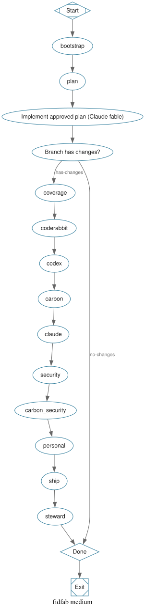
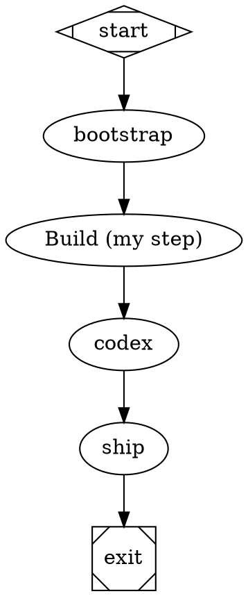

# fidfab

**The enlightened computational science factory for expert research software engineers.**

fidfab is a set of [Fabro](https://fabro.sh) workflows, reusable workflow components, and a
locally built Docker sandbox for human-driven, aligned agentic development of scientific
software. It emphasises **understanding** (plans and roadmaps you read and approve before code
is written), **verification** (coverage checks, multiple independent reviews, security and
personal-data audits, CI stewardship), and **reproducibility** (a pinned Ubuntu 24.04 image,
pixi and Rust toolchains, every step recorded in the Fabro run log).

Everything runs on your workstation: a local Fabro server, local Docker containers, and
leading models through your own Claude Code and Codex subscriptions over the
[Agent Client Protocol](https://agentclientprotocol.com) (ACP). Fabro-native steps default to
DeepSeek. The compute-heavy work (compilation, tests) uses the full local machine.

<p align="center">
  
</p>

- [How it fits together](#how-it-fits-together)
- [Workflows](#workflows)
- [Setup](#setup)
- [Running workflows](#running-workflows)
- [Using fidfab from another repository](#using-fidfab-from-another-repository)
- [VS Code](#vs-code)
- [Tests](#tests)
- [Repository layout](#repository-layout)
- [Known limitations](#known-limitations)
- [License](#license)

## How it fits together

```
 you ──(fabro run / web UI / VS Code)──▶ local Fabro server
                                           │  injects vault secrets, mints a scoped GITHUB_TOKEN
                                           ▼
                                   docker: fidfab:latest  (Ubuntu 24.04)
                                   ├── /workspace   clone of the target branch
                                   ├── claude-agent-acp ──▶ Claude Code (fable / opus)   subscription
                                   ├── codex-acp ────────▶ Codex (luna)                  subscription
                                   ├── coderabbit --agent
                                   ├── pixi, rust, vite+, serena, cocoindex-code, gh
                                   └── fidfab-* helpers (bootstrap, diff, pr-status, …)
```

1. You start a run with a goal (`--goal "…"` or `--goal-file task.md`). For `medium` and
   `large`, a Claude Code (fable) session first produces planning documents and pauses at a
   human gate; you approve or type feedback, as many rounds as needed.
2. Claude Code implements the approved plan in the sandbox.
3. The verification pipeline runs over the diff: coverage of uncovered behaviour (opus),
   CodeRabbit review and autonomous fix (opus, with a 3-minute retry and a fallback to Claude's
   built-in review), Codex (luna) review, Claude (fable) review, a security review, a
   personal-data decision with an optional Cloudflare security audit, each followed by an
   opus "verify and address" pass that writes a Markdown record of the approach taken per finding.
4. opus writes the commit, opens the PR with `gh pr create --fill`, then rewrites the title and
   body from the actual diff and task context.
5. A steward loop (opus) reads PR comments, addresses them, replies and resolves threads,
   rebases on conflicts, fixes failing CI, then waits an hour and repeats until the PR is quiet
   and green.

The models, effort levels, and tools for each step are declared in the DOT graphs under
`.fabro/workflows/` and the components under `components/`; the prompts are plain Markdown
under `components/prompts/`. The review prompt used by both the Codex and Claude review stages
is `components/prompts/partials/review-priorities.md`.

## Workflows

| Workflow | Start | Human gates | Output |
|---|---|---|---|
| `small` | One-shot prompt | none before implementation | Branch, verified diff, PR, stewarded to green |
| `medium` | `task_plan.md` / `findings.md` / `progress.md` via the [planning-with-files](https://github.com/OthmanAdi/planning-with-files) skill | plan approval loop | Plan files committed with the implementation, PR |
| `large` | Research-backed roadmap drafted interactively with Claude fable, critiqued by Codex luna | draft approval, final approval | `docs/roadmap/**.md` work items with implementation plans and acceptance criteria, each sized for `medium`; PR |
| `verify` | Existing branch | none | Verification pipeline only, PR and steward |

Graphs: [small](docs/graphs/small.svg) · [medium](docs/graphs/medium.svg) ·
[large](docs/graphs/large.svg) · [verify](docs/graphs/verify.svg). Re-render with
`scripts/render-graphs.sh`.

### Components

Each stage is a Fabro subgraph in `components/` that can be imported into your own workflows:

| Component | What it does |
|---|---|
| `bootstrap.fabro` | Materialises credentials, ensures the checkout (deepens Fabro's shallow clone, or clones from the image's baked-in repo), attaches warm caches, records base/head refs |
| `coverage.fabro` | opus checks the diff for uncovered behaviour and adds tests |
| `coderabbit-review.fabro` | `coderabbit review --agent`; if unavailable, waits 3 minutes and retries, then falls back to Claude's built-in code review; opus fixes issues following section "4. Fix Issues (Autonomous Workflow)" of the [CodeRabbit code-review skill](https://github.com/coderabbitai/skills) |
| `codex-review.fabro` | Codex (luna) review with the prioritised review prompt, then opus verifies and addresses, writing `docs/plans/<slug>/review-codex.md` |
| `claude-review.fabro` | Same review by Claude (fable), then opus verifies and addresses |
| `security-review.fabro` | opus security review of the changes, then verify and address |
| `personal-data-audit.fabro` | Codex decides whether the changes touch potentially personal data; if so runs the [Cloudflare security-audit skill](https://github.com/cloudflare/security-audit-skill) and opus addresses the findings |
| `commit-and-pr.fabro` | Descriptive commit, `gh pr create --fill`, then title and body rewritten from the diff |
| `pr-steward.fabro` | Hourly loop: comments, conflicts, CI; exits when all clear |
| `plan-with-files.fabro` | planning-with-files draft, human approve/revise loop |

## Setup

### Prerequisites

- Linux or macOS workstation with Docker (daemon running, your user can access the socket)
- A GitHub account with push access to the target repository
- Subscriptions or keys: Claude Pro/Max (for Claude Code), ChatGPT Plus/Pro or an OpenAI API key
  (for Codex), a [CodeRabbit](https://www.coderabbit.ai) account with an agentic API key, a
  [DeepSeek Platform](https://platform.deepseek.com/) key, a [Brave Search API](https://brave.com/search/api/) key
- Node.js 22+ on the host if you want `claude` and `codex` installed locally for login flows

### Guided setup

```bash
git clone https://github.com/fideus-labs/fidfab.git
cd fidfab
scripts/setup.sh            # all steps, interactive
scripts/setup.sh deepseek   # or one step at a time
```

The steps below are what the script does, if you prefer to run them yourself.

### 1. Install Fabro and upgrade to the latest pre-release

```bash
curl -fsSL https://fabro.sh/install.sh | bash
export PATH="$HOME/.fabro/bin:$PATH"
fabro upgrade --prerelease
fabro install             # wizard: LLM provider, GitHub, local server
fabro server start
```

The installer and the `--prerelease` upgrade channel are documented in the
[Fabro quick start](https://docs.fabro.sh/getting-started/quick-start).

### 2. DeepSeek as Fabro's default model

```bash
fabro provider login --provider deepseek      # or: fabro secret set DEEPSEEK_API_KEY
```

Then set the default model in `~/.fabro/settings.toml`:

```toml
[run.model]
name = "deepseek-v4-flash"
provider = "deepseek"
```

Restart the server (`fabro server restart`) and check with `fabro model test deepseek`.
DeepSeek V4 Flash is the provider default; `deepseek-v4-pro` is available for harder steps
([Fabro DeepSeek integration](https://docs.fabro.sh/integrations/deepseek)). Only Fabro-native
nodes use this model; the Claude Code and Codex stages use your subscriptions.

### 3. Brave Search

```bash
fabro secret set BRAVE_SEARCH_API_KEY
```

Fabro's `web_search` tool uses Brave whenever this key is in the server vault; it is not read
from the environment ([Fabro Brave Search integration](https://docs.fabro.sh/integrations/brave-search)).

### 4. Build the sandbox image

```bash
docker/build.sh                                      # generic image
docker/build.sh https://github.com/OWNER/REPO main   # with a baked-in clone and warm caches
docker/build.sh git@github.com:OWNER/REPO main       # private repo, cloned with your ssh-agent
```

The image starts from `ubuntu:24.04` and installs, in this order:
[pixi](https://pixi.sh) (environments detached under `/opt/fidfab/cache/pixi-envs`),
Rust via rustup with `cargo-nextest`, `cargo-llvm-cov`, `cargo-deny`, `cargo-audit`,
`wasm-pack` and [sccache](https://github.com/mozilla/sccache) as `RUSTC_WRAPPER` (25 GB local
cache under `/opt/fidfab/cache/sccache`), [Vite+](https://vite.plus), Node 22, Claude Code,
Codex, the
[Claude Code ACP adapter](https://github.com/agentclientprotocol/claude-agent-acp) and the
[Codex ACP adapter](https://github.com/agentclientprotocol/codex-acp), the
[CodeRabbit CLI](https://docs.coderabbit.ai/cli/overview), [Serena](https://github.com/oraios/serena)
wired into Claude Code as an MCP server, [cocoindex-code](https://github.com/cocoindex-io/cocoindex-code)
wired into Codex as an MCP server, and the planning-with-files, CodeRabbit code-review and
Cloudflare security-audit skills for both agents. The `gh` and `docker` CLIs are present for the
PR stages. Pin versions with `CLAUDE_CODE_VERSION`, `CODEX_VERSION`, `RUST_TOOLCHAIN`, etc.

With a repository URL, the build clones it to `/opt/fidfab/repo`, pre-builds its pixi and
Cargo dependencies (a Rust repository is built through sccache, so its cache is warm), and
`fidfab-bootstrap` reuses those caches in every run. Nothing secret is baked into the image.

Private repositories can be given as SSH URLs. `build.sh` then forwards your ssh-agent to the
clone step only (`docker build --ssh default`), so `ssh-add` your GitHub key first; the key never
reaches an image layer. GitHub's host keys, for `github.com` and the port-443 endpoint
`ssh.github.com`, are pinned in `docker/rootfs/etc/ssh/ssh_known_hosts`. The baked clone's
`origin` is rewritten to HTTPS on `github.com`, because sandboxes authenticate to GitHub with
Fabro's `GITHUB_TOKEN` rather than an SSH key.

### 5. Agent credentials (Fabro vault)

Secrets live in the Fabro server vault and are injected into the sandbox as environment
variables by `[run.environment.env]` in each `workflow.toml`
([run configuration](https://docs.fabro.sh/execution/run-configuration)).

**Claude Code ACP**

```bash
claude setup-token                       # on the host, logs in with your Claude subscription
fabro secret set CLAUDE_CODE_OAUTH_TOKEN # paste the sk-ant-oat… token
```

`claude-agent-acp` honours Claude Code's environment, so the token and `ANTHROPIC_MODEL`
select the account and model. Set `FIDFAB_MODEL_OPUS` / `FIDFAB_MODEL_FABLE` in
`[run.environment.env]` to pin exact model IDs (defaults pass `opus` / `fable` through).

**OpenAI Codex ACP**

```bash
codex login --device-auth                # on the host, ChatGPT subscription
base64 -w0 ~/.codex/auth.json | fabro secret set --value-stdin CODEX_AUTH_JSON_B64
# or with an API key:
printf '{"OPENAI_API_KEY":"sk-…"}' | base64 -w0 | fabro secret set --value-stdin CODEX_AUTH_JSON_B64
```

`fidfab-bootstrap` writes this to `$CODEX_HOME/auth.json` inside the sandbox; `codex-acp`
reads the same auth store as the Codex CLI ([codex-acp](https://github.com/agentclientprotocol/codex-acp)).
Subscription tokens rotate, so re-run this step if Codex stages stop authenticating.

**CodeRabbit CLI**

```bash
fabro secret set CODERABBIT_API_KEY      # agentic API key from the CodeRabbit dashboard
```

The sandbox runs `coderabbit auth login --api-key …` and then `coderabbit review --agent --base <branch>`
([CodeRabbit headless integration](https://docs.coderabbit.ai/cli/headless-cli-integration)).
Set `CODERABBIT_REGION=eu` in `[run.environment.env]` for EU accounts.

### 6. Verify the image

```bash
tests/test-image.sh                      # tools, coderabbit, claude-acp, codex-acp
CLAUDE_CODE_OAUTH_TOKEN=… CODEX_AUTH_JSON_B64=… CODERABBIT_API_KEY=… tests/test-image.sh
```

Without credentials the tests check installation and the ACP `initialize` handshake. With
credentials they run an authenticated `session/prompt` round-trip against each agent and
`coderabbit auth status`.

### 7. Register the environment and run the doctor

`workflow.toml` declares the `fidfab` Docker environment itself, so the workflows run as soon
as the image exists. To make it visible server-wide (for the web UI and your own workflows),
`scripts/setup.sh environment` appends the same `[environments.fidfab]` table to
`~/.fabro/settings.toml`.

```bash
fabro doctor
```

Expect green for the local server, LLM provider (DeepSeek), GitHub token, Docker sandbox, and
Web Search (`brave: configured and reachable`).

## Running workflows

From a checkout that contains fidfab (this repository, a subtree, or a copy of
`.fabro/workflows/<name>/`):

```bash
fabro run small  --goal "Add a --threads flag to the converter; default to the CPU count"
fabro run medium --goal-file task.md -I plan_slug=2026-10-24-threads
fabro run large  --goal "Roadmap for streaming OME-Zarr writes" -I plans_dir=docs/roadmap
fabro run verify --goal "Verify the current branch"
```

Against another repository, from anywhere:

```bash
fabro run fideus-labs/fidfab:small --goal-file task.md --target OWNER/REPO@feature-branch
```

Human gates (plan and roadmap approvals) are answered in the terminal when `fabro run` is
attached, or in the run page of the Fabro web UI; type feedback to request a revision, pick
"Approve" to continue ([interviews](https://docs.fabro.sh/human-tools/interviews)). Use
`--auto-approve` only for unattended runs. `fabro steer` can redirect an agent mid-step, and
`fabro events`, `fabro inspect` and `fabro artifact` expose every step for review afterwards.

Inputs (`-I key=value`): `plans_dir` (default `docs/plans`, `docs/roadmap` for `large`),
`plan_slug` (default `task`), `draft_pr` (`true`/`false`).

### Interactive Claude Code session first, then the factory

Many tasks start as an exploratory conversation. The sandbox supports both orders:

```bash
# 1. Explore in an interactive Claude Code session (host or dev container), on a worktree:
git worktree add ../repo-threads -b threads
cd ../repo-threads && claude
# 2. Push the branch and let the factory verify, review, and steward it:
git push -u origin threads
fabro run verify --goal "Verify and land the threads branch" --target OWNER/REPO@threads
```

Or start the prompt in fabro with `small`/`medium` and, if you want to take over by hand,
keep the sandbox (`--preserve-sandbox`), attach with `fabro sandbox ssh` or VS Code (below),
and resume.

## Using fidfab from another repository

**As a git subtree** (recommended when you want to version the workflows with your code):

```bash
git subtree add --prefix fidfab https://github.com/fideus-labs/fidfab.git main --squash
mkdir -p .fabro/workflows/small
cp fidfab/.fabro/workflows/small/workflow.{toml,fabro} .fabro/workflows/small/
fidfab/scripts/sync-components.sh .fabro/workflows/small     # vendors components/ beside the graph
fabro run small --goal "…"
# later
git subtree pull --prefix fidfab https://github.com/fideus-labs/fidfab.git main --squash
```

**As components in your own graph**: import any `components/*.fabro` subgraph from a
workflow directory that has been synced with `sync-components.sh`:



**Remote reference**: `fabro run fideus-labs/fidfab@main:medium …` resolves to
`.fabro/workflows/medium/` in this repository without any local copy.

Fabro resolves `@prompt` paths relative to the importing workflow's directory and rejects
paths that escape it, which is why components are vendored next to each graph; CI checks that
the vendored copies match `components/` (`scripts/sync-components.sh --check`).

## VS Code

Three ways to work with fidfab from VS Code:

**Interactive Claude Code in the sandbox image (Dev Containers).** The repository ships
`.devcontainer/devcontainer.json`, which opens your checkout inside `fidfab:latest` with the
Claude Code and Codex extensions, Serena, and the warm pixi/Cargo caches. Put the agent
credentials in `~/.config/fidfab/agents.env` on the host:

```
CLAUDE_CODE_OAUTH_TOKEN=sk-ant-oat…
CODEX_AUTH_JSON_B64=…
CODERABBIT_API_KEY=cr-…
```

then "Dev Containers: Reopen in Container". Run `claude` or `codex` in the integrated terminal,
diff the resulting worktree, and hand the branch to `fabro run verify`. Copy the
`.devcontainer/` folder into any target repository to get the same experience there.

**Attach to a running workflow sandbox.** Start the run with `--preserve-sandbox`, find the
container with `docker ps` (named after the run), then "Dev Containers: Attach to Running
Container". You can inspect the agents' edits in `/workspace`, read the planning files, and
run tests while the workflow is paused at a gate. `fabro sandbox ssh <run>` is the terminal
equivalent.

**Fabro's VS Code remote view.** Fabro can open a VS Code tunnel into cloud (Daytona)
sandboxes ([VS Code access](https://docs.fabro.sh/human-tools/vs-code)); for local Docker
sandboxes use the two options above.

Recommended host extensions: `anthropic.claude-code`, `openai.chatgpt` (Codex),
`tamasfe.even-better-toml` for `workflow.toml`, and a Graphviz preview extension for `.fabro` files
(they are DOT).

## Tests

| Test | Where it runs | Checks |
|---|---|---|
| `tests/validate-workflows.sh` | host, CI | `fabro validate` on every workflow |
| `scripts/sync-components.sh --check` | host, CI | vendored components match `components/` |
| `tests/test-tools.sh` | image | pixi, rustup/cargo, vite+, claude, codex, coderabbit, serena, ccc, gh, skills present |
| `tests/test-coderabbit.sh` | image | CLI installed; with `CODERABBIT_API_KEY`, `auth login` and `auth status --agent` succeed |
| `tests/test-claude-acp.sh` | image | ACP `initialize` handshake; with a token, a full `session/prompt` round-trip returns the expected marker |
| `tests/test-codex-acp.sh` | image | Same for Codex |
| `tests/test-image.sh` | host | Runs the image tests in `docker run`, passing credentials through |

`tests/acp-smoke.mjs` is a dependency-free ACP client (JSON-RPC over stdio) used by both ACP
tests; it follows the protocol's `initialize` → `session/new` → `session/prompt` sequence
([ACP schema](https://agentclientprotocol.com/protocol/schema)).

GitHub Actions (`.github/workflows/ci.yml`) runs validation, shellcheck, hadolint, and the
Node syntax check on every push and PR; the image build and tool tests run on manual dispatch.

## Repository layout

```
components/              canonical Fabro subgraphs and prompts (edit here)
  prompts/               Markdown prompts; partials/ included with 
.fabro/
  project.toml           Fabro project metadata
  workflows/<name>/      workflow.toml + workflow.fabro + vendored components/ (generated)
docker/
  Dockerfile             ubuntu:24.04 sandbox image
  build.sh               local build with optional baked-in target repository
  config/                Claude Code and Codex settings baked into the image
  rootfs/usr/local/bin/  fidfab-* helpers used by the workflows
scripts/
  setup.sh               host setup (Fabro, DeepSeek, Brave, agents, environment, doctor)
  sync-components.sh     vendor components/ into workflow directories
  render-graphs.sh       docs/graphs/*.svg
tests/                   image tests, ACP smoke client, workflow validation
docs/graphs/             rendered workflow graphs
.devcontainer/           VS Code dev container on the sandbox image
```

## Known limitations

- The workflows are validated offline with `fabro validate` and the ACP handshake has been
  tested against the published adapters; end-to-end runs depend on your subscriptions and
  the first full image build on your machine.
- Fabro's standalone runner ignores `[run.integrations]`; the server-managed run path mints the
  GitHub token. Running under `fabro run` against a local server is the supported mode.
- Fabro resolves component prompt paths relative to the importing workflow, so components are
  vendored per workflow (`scripts/sync-components.sh`). Nested imports (a component importing
  a component) are avoided for the same reason.
- `fabro graph` needs a ready LLM provider on the server before it renders.
- Subscription credentials (Claude Code OAuth token, Codex `auth.json`) expire and rotate;
  `scripts/setup.sh claude` / `scripts/setup.sh codex` refresh them.

## License

MIT. Copyright (c) 2026 Fideus Labs LLC. See [LICENSE](LICENSE).
