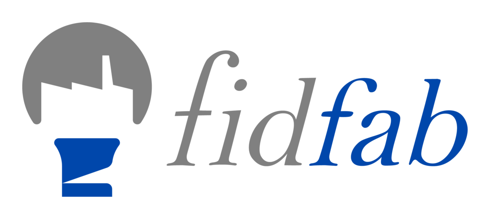

<p align="center">
  
</p>

<p align="center">
  <a href="https://github.com/fideus-labs/fidfab/actions/workflows/ci.yml"></a>
  <a href="https://github.com/fideus-labs/fidfab/blob/main/LICENSE"></a>
</p>

<p align="center">
  <a href="https://fabro.sh">Fabro</a> workflows, reusable workflow components, and a locally
  built Docker sandbox for human-driven, aligned agentic development of scientific software,
  turning a goal into a planned, verified, and reviewed pull request.
</p>

<p align="center">
  Everything runs on your workstation: a local Fabro server, local Docker containers, and
  leading models through your own Claude Code and Codex subscriptions over the
  <a href="https://agentclientprotocol.com">Agent Client Protocol</a>.
</p>

<p align="center">
  fidfab is the enlightened computational science factory for expert research software engineers.
</p>

## ✨ Features

- 🧭 **Understanding** -- plans and roadmaps you read and approve at a human gate, as many
  rounds as needed, before code is written.
- 🔬 **Verification** -- a coverage check, CodeRabbit, Codex and Claude reviews, a security
  review and a personal-data audit run over the diff; the findings of each review are
  verified and addressed, with a Markdown record of the approach taken per finding.
- 📌 **Reproducibility** -- a pinned Ubuntu 26.04 image with pixi and Rust toolchains, and
  every step recorded in the Fabro run log.
- 🏠 **Local-first** -- a local Fabro server and local Docker containers; compilation and
  tests use the full local machine.
- 🔑 **Your own subscriptions** -- Claude Code and Codex run over ACP on your subscriptions;
  secrets live in the Fabro vault, and nothing secret is baked into the image.
- 🛡️ **Untrusted review comments** -- by default you screen each round of pull request review
  comments before an agent reads them, and approve the replies before they are posted.
- 🚦 **PR stewardship** -- an hourly loop addresses review threads, rebases on conflicts and
  fixes failing CI until the pull request is quiet and green.
- 🧹 **Logical commit history** -- the per-stage checkpoints are rewritten into logically
  related commits with meaningful messages, without changing the code.
- 🧱 **Reusable components** -- each stage is a Fabro subgraph you can import into your own
  workflows.

## 🧩 Workflows

| Workflow | Start | Human gates | Output |
|---|---|---|---|
| `small` | One-shot prompt | none before implementation; steward review screening and reply approval | Branch, verified diff, PR, stewarded to green |
| `medium` | `task_plan.md` / `findings.md` / `progress.md` via the [planning-with-files](https://github.com/OthmanAdi/planning-with-files) skill | plan approval loop; steward review screening and reply approval | Plan files committed with the implementation, PR |
| `large` | Research-backed roadmap drafted interactively with Claude fable, critiqued by Codex terra | draft approval, final approval; steward review screening and reply approval | `docs/roadmap/**.md` work items with implementation plans and acceptance criteria, each sized for `medium`; PR |
| `verify` | Existing branch | steward review screening and reply approval | Verification pipeline only, PR and steward |

The steward gates are on by default and only appear when a PR has review threads awaiting a
reply; `-I steward_gate=false` turns them off for private repositories.

<p align="center">
  
</p>

Graphs: [small](docs/graphs/small.svg) · [medium](docs/graphs/medium.svg) ·
[large](docs/graphs/large.svg) · [verify](docs/graphs/verify.svg). Re-render with
`scripts/render-graphs.sh`.

## 🧱 Components

Each stage is a Fabro subgraph in `components/` that can be imported into your own workflows:

| Component | What it does |
|---|---|
| `bootstrap.fabro` | Materialises credentials, ensures the checkout (deepens Fabro's shallow clone, or clones from the image's baked-in repo), attaches warm caches, records base/head refs and the plan slug |
| `coverage.fabro` | opus checks the diff for uncovered behaviour and adds tests |
| `coderabbit-review.fabro` | `coderabbit review --agent` in a script node that fails unless the review completed; if CodeRabbit is not logged in it waits 3 minutes and checks again; a review that cannot run stops at a gate (retry, or Claude's built-in code review, recorded as such); opus fixes issues following section "4. Fix Issues (Autonomous Workflow)" of the [CodeRabbit code-review skill](https://github.com/coderabbitai/skills) |
| `codex-review.fabro` | Codex (terra) review with the prioritised review prompt, then opus verifies and addresses, writing `docs/plans/<slug>/review-codex.md`; a failed review stops at a gate (retry, or continue without it, recorded in `.fidfab/reviews/`) |
| `claude-review.fabro` | Same review by Claude (fable), then opus verifies and addresses |
| `security-review.fabro` | opus security review of the changes, then verify and address |
| `personal-data-audit.fabro` | Codex decides whether the changes touch potentially personal data; if so runs the [Cloudflare security-audit skill](https://github.com/cloudflare/security-audit-skill) and opus addresses the findings |
| `commit-and-pr.fabro` | Descriptive commit, `gh pr create --fill`, then title and body rewritten from the diff |
| `pr-steward.fabro` | Hourly loop: review threads (human-screened, replies approved before posting, unless `steward_gate=false`), conflicts, CI; exits when all clear |
| `logical-commits.fabro` | After the steward, if it ended green and quiet: opus rewrites the branch into logically related commits with meaningful messages, leaving the code unchanged, and force-pushes the pull request branch |
| `plan-with-files.fabro` | planning-with-files draft, human approve/revise loop |

## 🏭 How It Fits Together

```text
 you ──(fabro run / web UI / VS Code)──▶ local Fabro server ──▶ LiteLLM proxy (127.0.0.1:4000)
                                           │                       └─▶ Vertex AI: Gemini 3.8 Flash,
                                           │                           Gemini 4 Carbon
                                           │  injects vault secrets and GITHUB_TOKEN
                                           ▼
                                   docker: fidfab:latest  (Ubuntu 26.04)
                                   ├── /workspace   clone of the target branch
                                   ├── claude-agent-acp ──▶ Claude Code (fable / opus)   subscription
                                   ├── codex-acp ────────▶ Codex (terra)                 subscription
                                   ├── coderabbit --agent
                                   ├── pixi, rust, vite+, serena, cocoindex-code, gh
                                   └── fidfab-* helpers (bootstrap, diff, pr-status, …)
```

The Claude Code and Codex stages use your subscriptions; Fabro-native steps default to Gemini
3.8 Flash on Google Cloud Vertex AI, reached through a local LiteLLM proxy.

1. **Plan** -- you start a run with a goal (`--goal "…"` or `--goal-file task.md`). For
   `medium` and `large`, Claude Code (fable) first produces planning documents and pauses at a
   human gate; you approve or type feedback, as many rounds as needed.
2. **Implement** -- Claude Code implements the approved plan in the sandbox.
3. **Verify** -- the verification pipeline runs over the diff: a coverage check, then
   CodeRabbit, Codex (terra) and Claude (fable) reviews, a security review and the
   personal-data audit. opus verifies and addresses the findings of each review and writes a
   Markdown record of the approach taken per finding.
4. **Ship** -- opus writes the commit, opens the PR with `gh pr create --fill`, then rewrites
   the title and body from the actual diff and task context.
5. **Steward** -- a loop (opus) addresses review threads, rebases on conflicts, fixes failing
   CI, then waits an hour and repeats until the PR is quiet and green.
6. **Tidy** -- opus rewrites the branch's commits into logically related ones, without
   changing the code, and force-pushes the pull request branch.

The models, effort levels, and tools for each step are declared in the DOT graphs under
`.fabro/workflows/` and the components under `components/`; the prompts are plain Markdown
under `components/prompts/`. See [`docs/workflows.md`](docs/workflows.md) for the full
walk-through: what happens when a review cannot run, the effort level of each stage, the
steward gates and the history rewrite.

## 🚀 Quick Start

A run is `fabro run <workflow>` with a goal. Once the [setup](docs/setup.md) is done, from a
checkout that contains fidfab (this repository, a subtree, or a copy of
`.fabro/workflows/<name>/`):

```bash
# One-shot prompt -> implementation -> verified diff -> stewarded pull request
fabro run small  --environment fidfab --goal "Add a --threads flag to the converter; default to the CPU count"

# Plan first, approve it at a human gate, then implement
fabro run medium --environment fidfab --goal-file task.md -I plan_slug=2026-10-24-threads

# Research-backed roadmap of work items, each sized for `medium`
fabro run large  --environment fidfab --goal "Roadmap for streaming OME-Zarr writes" -I plans_dir=docs/roadmap

# Verification pipeline, pull request and steward for an existing branch
fabro run verify --environment fidfab --goal "Verify the current branch"

# Against another repository, from anywhere
fabro run fideus-labs/fidfab:small --environment fidfab --goal-file task.md --target OWNER/REPO@feature-branch
```

`--environment fidfab` is required: without it Fabro runs in its `default` image, where the
first stage fails with `fidfab-bootstrap: command not found`. Human gates are answered in the
terminal when `fabro run` is attached, or in the run page of the Fabro web UI. See
[`docs/workflows.md`](docs/workflows.md#running-workflows) for the inputs, the plan slug, the
gates, and how to use fidfab from another repository.

## 🛠️ Development

fidfab is small on purpose: a handful of Fabro components, the prompts they run, a Docker
image, and tests. All commands run from the repository root.

### 📋 Prerequisites

- Linux or macOS workstation with Docker (daemon running, your user can access the socket), or Windows WSL with Docker Desktop
- A GitHub account with push access to the target repository, logged in with the `gh` CLI
  (`gh auth login`; `fabro install` takes its GitHub token from `gh auth token`, which a GitHub
  App replaces with one scoped to each run's repository:
  [docs/github-token.md](docs/github-token.md))
- Subscriptions or keys: Claude Pro/Max (for Claude Code), ChatGPT Plus/Pro or an OpenAI API key
  (for Codex), a [CodeRabbit](https://www.coderabbit.ai) account with an agentic API key, a
  [Brave Search API](https://brave.com/search/api/) key
- A Google Cloud project with billing and the Vertex AI API enabled, plus a service account key
  for the local LiteLLM proxy ([docs/vertex-ai-litellm.md](docs/vertex-ai-litellm.md))
- Node.js 22+ on the host if you want `claude` and `codex` installed locally for login flows

### 🔧 Setup

```bash
git clone https://github.com/fideus-labs/fidfab.git
cd fidfab
scripts/litellm-proxy.sh init PROJECT_ID   # then put the service-account key where it says
scripts/litellm-proxy.sh start             # Gemini on Vertex AI through a local LiteLLM proxy
docker/build.sh                            # the sandbox image
scripts/setup.sh                           # every host step, interactive
tests/test-image.sh                        # tools, coderabbit, claude-acp, codex-acp
```

`scripts/setup.sh` installs Fabro, stores the agent credentials in its vault and registers the
`fidfab` environment; each step also runs on its own (`scripts/setup.sh litellm`). It does not
create or start the LiteLLM proxy, which needs your Google Cloud project and service-account
key. See [`docs/setup.md`](docs/setup.md) for every step by hand, and
[`docs/github-token.md`](docs/github-token.md) to give each run a GitHub token limited to its
own repository.

### 🏗️ Repository Structure

```text
components/              canonical Fabro subgraphs and prompts (edit here)
  prompts/               Markdown prompts; partials/ included with 
.fabro/
  project.toml           Fabro project metadata
  workflows/<name>/      workflow.toml + workflow.fabro + vendored components/ (generated)
docker/
  Dockerfile             ubuntu:26.04 sandbox image
  build.sh               local build with optional baked-in target repository
  config/                Claude Code and Codex settings baked into the image
  rootfs/usr/local/bin/  fidfab-* helpers used by the workflows
  rootfs/usr/local/lib/fidfab/  jq library: quote.jq renders untrusted text inert
  litellm/config.yaml    LiteLLM proxy model list (Gemini on Vertex AI)
scripts/
  setup.sh               host setup (Fabro, git author, LiteLLM provider, Brave, agents, environment, doctor, GitHub App)
  litellm-proxy.sh       init/start/stop/status/test the local LiteLLM proxy for Vertex AI
  sync-components.sh     vendor components/ into workflow directories
  render-graphs.sh       docs/graphs/*.svg
tests/                   image tests, ACP smoke client, workflow validation
docs/
  setup.md               guided setup and each step by hand
  workflows.md           the pipeline in detail, running workflows, steward gates, commit history
  vertex-ai-litellm.md   Google Cloud project, service account, monitoring, and proxy setup
  github-token.md        GitHub App or scoped token for Fabro runs
  vscode.md              dev container, attaching to a running sandbox
  testing.md             every test and what it checks
  limitations.md         known limitations
  graphs/                rendered workflow graphs
.devcontainer/           VS Code dev container on the sandbox image
```

### 📝 Commands

| Command | Description |
| ------- | ----------- |
| `scripts/setup.sh [step]` | Host setup: Fabro, git author, LiteLLM provider, Brave, agents, environment, doctor, GitHub App |
| `scripts/litellm-proxy.sh <command>` | `init`, `start`, `stop`, `status` or `test` the local LiteLLM proxy for Vertex AI |
| `docker/build.sh [REPO BRANCH]` | Build the sandbox image, optionally with a baked-in clone and warm caches |
| `tests/test-image.sh` | Run the image tests in `docker run`, passing credentials through |
| `tests/validate-workflows.sh` | `fabro validate` on every workflow |
| `scripts/sync-components.sh` | Vendor `components/` into the workflow directories (`--check` compares the copies) |
| `scripts/render-graphs.sh` | Re-render `docs/graphs/*.svg` |

See [`docs/testing.md`](docs/testing.md) for every test and what it checks, and
[`AGENTS.md`](AGENTS.md) for the tests each kind of change needs.

## 📚 Documentation

- [Setup](docs/setup.md) -- the guided script and each step by hand
- [Workflows](docs/workflows.md) -- the pipeline in detail, effort levels, running workflows,
  review-comment gates, commit history, and using fidfab from another repository
- [GitHub token](docs/github-token.md) -- a GitHub App or a scoped token for Fabro runs
- [Vertex AI through LiteLLM](docs/vertex-ai-litellm.md) -- Google Cloud project, service
  account, monitoring, and proxy setup
- [VS Code](docs/vscode.md) -- the dev container, and attaching to a running sandbox
- [Tests](docs/testing.md) -- every test, where it runs, and what it checks
- [Known limitations](docs/limitations.md)

## 🤝 Contributing

Contributions are welcome. Start with [`CONTRIBUTING.md`](CONTRIBUTING.md) for the ground rules
and the development loop, and [`AGENTS.md`](AGENTS.md) for the repository layout, the
verification each change needs, and the Fabro constraints we have learned.

## 📄 License

[MIT](LICENSE) -- Copyright (c) 2026 Fideus Labs LLC
