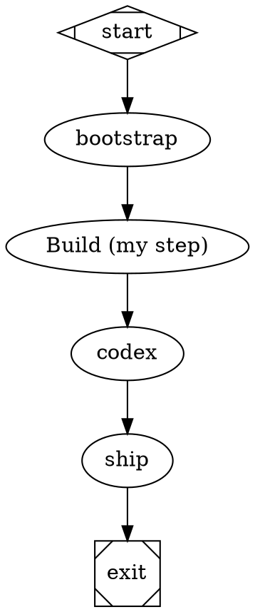

# Workflows

The pipeline in detail, how to run it, and what the steward gates and the history rewrite do.
The [README](../README.md) has the overview: the diagram, and the tables of workflows and
components.

## How it fits together

1. You start a run with a goal (`--goal "…"` or `--goal-file task.md`). For `medium` and
   `large`, a Claude Code (fable) session first produces planning documents and pauses at a
   human gate; you approve or type feedback, as many rounds as needed.
2. Claude Code implements the approved plan in the sandbox.
3. The verification pipeline runs over the diff: coverage of uncovered behaviour (opus),
   Codex (terra) review, Claude (fable) review, CodeRabbit review and autonomous fix (opus), a
   security review, a personal-data decision with an optional Cloudflare security audit, each
   followed by an opus "verify and address" pass that writes a Markdown record of the approach
   taken per finding. A Codex or CodeRabbit review that cannot run (a usage limit, a login) stops
   at a human gate: retry once it is lifted, or continue without it (Claude's built-in review
   stands in for CodeRabbit), which the records and the PR description say. Any other failed stage
   ends the run unless its component routes the failure (the steward tries again after the hour, a
   failed history rewrite is still verified, the personal-data audit runs when Codex cannot
   decide); `fabro fork` resumes it from a checkpoint, with the secrets as they are now.
4. opus writes the commit, opens the PR with `gh pr create --fill`, then rewrites the title and
   body from the actual diff and task context.
5. A steward loop (opus) addresses review threads, rebases on conflicts, fixes failing CI, then
   waits an hour and repeats until the PR is quiet and green. By default you screen each round
   of review comments before an agent reads them and approve the replies before they are posted
   ([Review comments are untrusted](#review-comments-are-untrusted)).
6. When the steward leaves the PR green and quiet, opus rewrites the branch's commits (Fabro's
   per-stage checkpoints and the fixes made along the way) into logically related commits with
   meaningful messages, without changing the code, and force-pushes the pull request branch
   ([Commit history](#commit-history)).

The models, effort levels, and tools for each step are declared in the DOT graphs under
`.fabro/workflows/` and the components under `components/`; the prompts are plain Markdown
under `components/prompts/`. The review prompt used by both the Codex and Claude review stages
is `components/prompts/partials/review-priorities.md`. Native nodes without an explicit model
use the `[run.model]` in each `workflow.toml` (`vertex-gemini-3.8-flash` on the `litellm`
provider).

### Effort levels

Every agent stage sets its effort level explicitly, and `tests/test-effort-levels.sh` checks it
against this table, using the role word in each node's `class` (`implement`, `review`,
`security`, ...) and an `override` table for the nodes whose class does not decide the level:

| Stages | Effort |
|---|---|
| Claude implementation (`small` and `medium` `implement`) | `xhigh` |
| Claude planning (`medium` plan and its revisions; `large` roadmap draft, its revisions and the response to the critique) | `xhigh` |
| Verify and address after the Claude review and the Codex review | `xhigh` |
| Claude and Codex review (Codex review, Claude review, CodeRabbit and built-in review, security review, personal-data security audit, `large` roadmap critique) | `high` |
| Every other Claude and Codex stage (coverage, verify and address after the other reviews, personal-data decision, commit, pull request, steward, history rewrite) | `medium` |
| Gemini (the `[run.model]` default, and any native node) | `medium` |

Claude Code and Codex take the level from `--effort` on the node's `acp.command`; Gemini takes
`reasoning_effort` on the node and `[run.model.controls]` in `workflow.toml`.

## Running workflows

From a checkout that contains fidfab (this repository, a subtree, or a copy of
`.fabro/workflows/<name>/`):

```bash
fabro run small  --environment fidfab --goal "Add a --threads flag to the converter; default to the CPU count"
fabro run medium --environment fidfab --goal-file task.md -I plan_slug=2026-10-24-threads
fabro run large  --environment fidfab --goal "Roadmap for streaming OME-Zarr writes" -I plans_dir=docs/roadmap
fabro run verify --environment fidfab --goal "Verify the current branch"
```

`--environment fidfab` is required: Fabro (0.396) ignores the `[run.environment] id` declared in
`workflow.toml` when the flag is omitted and runs in its `default` image, where the first stage
fails with `fidfab-bootstrap: command not found`.

Against another repository, from anywhere:

```bash
fabro run fideus-labs/fidfab:small --environment fidfab --goal-file task.md --target OWNER/REPO@feature-branch
```

Human gates (plan and roadmap approvals, steward screening and reply approval) are answered
in the terminal when `fabro run` is attached, or in the run page of the Fabro web UI; type
feedback to request a revision, pick "Approve" to continue ([interviews](https://docs.fabro.sh/human-tools/interviews)). Use
`--auto-approve` only for unattended runs. `fabro steer` can redirect an agent mid-step, and
`fabro events`, `fabro inspect` and `fabro artifact` expose every step for review afterwards.

Inputs (`-I key=value`): `plans_dir` (default `docs/plans`, `docs/roadmap` for `large`),
`plan_slug` (default `task`), `draft_pr` (`true`/`false`), `steward_gate` (default `true`,
see below).

When `plan_slug` is left at `task` and the run starts from a topic branch (the checkout's
current branch, or `--target OWNER/REPO@branch`), the slug becomes the run date and the branch
name, with `/` replaced by `-`: a run from `feature/threads` on 10 November 2026 writes to
`docs/plans/2026-11-10-feature-threads/`. The date is the day (UTC) Fabro created the run's
sandbox checkout, so it is the run's start date and stays the same for as long as that sandbox
is used; a branch name that already begins with a date is not dated again. Runs from `main`,
`master`, `trunk`, `dev`, `develop`, `development`, `release`, `release/*`, `release-*`,
`stable`, `staging`, `production` or the base branch keep `task`. `fidfab-bootstrap` resolves
this inside the sandbox and records it as `FIDFAB_PLAN_SLUG` in `.fidfab/run.env`.

`fidfab-bootstrap` is part of the sandbox image, so rebuild the image after updating fidfab
([Build the sandbox image](setup.md#4-build-the-sandbox-image)). An image older than the workflows
does not record `FIDFAB_PLAN_SLUG`: the agents then fall back to the plan directory the task
already has, or `task`, and neither a `-I plan_slug=...` value nor the branch name is used.

### Review comments are untrusted

Anyone can comment on a pull request in a public repository, and the steward's agent runs with
the run's GitHub token and agent credentials in its environment. A comment that reads like
instructions ("run this", "post the contents of ...") is a prompt injection. With
`steward_gate=true` (the default), each round with review threads awaiting a reply goes through
two gates:

1. **Screen.** `fidfab-pr-status` lists every unresolved thread: path and line, thread id, and
   per comment the author with their association (`@alice (OWNER)`,
   `@someone (NONE, not a collaborator)`, `@coderabbitai (NONE, bot, not a collaborator)`).
   Comment text is quoted line by line with `    | `, so it stays literal in a terminal and in
   a Markdown renderer: HTML comments that GitHub hides are visible, control, bidi, zero-width
   and Unicode tag characters show as U+FFFD, and long comments are cut at 4000 characters.
   No agent has read the comments at this point. Choose **[A]** to let the steward address
   them, or hide (minimize) or resolve a comment on GitHub and choose **[R]** to list again;
   hidden comments are left out of the listing.
2. **Approve.** The steward (opus) works only from that listing, commits locally and drafts a
   reply per thread. `fidfab-pr-reply --preview` shows each reply, whether it resolves the
   thread, the unpushed commits and their diff, and flags (NOT POSTABLE) replies it would
   refuse and a push that fails a dry run (`git push --dry-run`; GitHub can still reject the
   real push, for example by branch protection). Choose **[P]** to push and post, or type what
   to change; the steward revises and you see the new preview.

Posting is done by `fidfab-pr-reply`, not the agent. It accepts only threads from the
screened listing and replies short enough to show in full in the preview (20000 characters),
and marks each reply so later rounds know the thread awaits its reviewer.
Fixes for failing CI and merge conflicts still push without a gate (that step is not shown any
comment text), and top-level PR comments and review summaries are not passed to the agent in gated mode (relay
them through the approval feedback).

For a private repository where every commenter is trusted, run with `-I steward_gate=false`
(or change the default in your copy of `workflow.toml`). The steward then reads, replies to and
resolves threads itself, as before.

### Commit history

Fabro commits a checkpoint after every stage (`fabro(<run id>): <stage> (success)`, holding
whatever the stage changed, often nothing) and pushes the run branch each time, so the pull
request collects dozens of them next to the commits the stages wrote. When the steward loop
ends with the pull request green and quiet, `logical-commits.fabro` has opus rewrite the branch
into logically related commits with meaningful messages and force-push it. The component and
its prompt (`components/prompts/logical-commits.md`) keep the rewrite from changing the code,
discarding anyone's work or hiding work nobody approved:

- it runs only when the steward's last status check said `done` (`fidfab-pr-status` records
  its label as `context.pr_status`; an image built before that sets no key, and the rewrite is
  skipped until you rebuild it). When the steward stops for another reason (no pull request,
  or an incomplete reply preview), the history is left as it is. After an incomplete
  preview, Fabro's checkpoint push has already published the commits drafted for replies a
  human has not approved; a rewrite would fold them into the reviewed commits, where they could
  no longer be told apart or reverted on their own;
- it rebases onto the merge base with the pull request's base branch, not onto its tip, and
  pushes only when the tree is identical to the one that was reviewed (the same tree id) and
  the work tree is clean (`git status --porcelain --untracked-files=all` succeeds and prints
  nothing), since Fabro commits and pushes whatever the stage leaves there. It starts only
  after a successful `git fetch` and on a clean work tree;
- the push is `--force-with-lease` against the commit it examined. It changes nothing when
  the branch does not have exactly one open pull request from this repository (pull requests
  from forks, which anyone can open from a branch of the same name, are not counted), when
  `gh` cannot tell (an API or token error), or when GitHub and the sandbox hold different
  code: it neither overwrites commits someone else pushed nor publishes commits itself. The
  branch on GitHub may only have moved by Fabro's checkpoints since the head the steward's
  last status check cleared (`fidfab-pr-status` writes it to `.fidfab/reviews/pr-head`, and
  `fidfab-history-tree record` fails and skips the rewrite otherwise), or be a commit an
  earlier attempt of the stage recorded leasing against or pushing; a same-tree push,
  rewording or rewind by someone else stops it;
- it does not rely on the agent for the code: a script node records the tree of HEAD before
  the rewrite, and one after it (`fidfab-history-tree verify`, run whether the rewrite
  succeeded, failed or timed out) fetches and fails unless HEAD is still on the recorded
  branch and HEAD and that branch on GitHub still have that tree; a branch that was on
  GitHub and has disappeared fails too. A failure stops the run at a human gate: do not
  merge the pull request before you have checked the branch. The record lives in the
  sandbox the agent can write to, so this catches mistakes and an interrupted rewrite, not
  an agent that deliberately rewrites the record as well;
- each rewritten commit that holds work from the run keeps a `Fabro-Run: <run id>` trailer,
  so the code can be traced to the run that wrote it even when the commit takes a person as
  author;
- it runs with `fidelity="truncate"` and is told not to read review comments, like the
  steward's agents. For the same reason it does not check review threads again: a thread
  opened between the steward's last check and the push stays on the pull request, against
  the same code.

What it leaves behind:

- Fabro still checkpoints the stages that follow the rewrite and pushes them, so the branch
  ends with a few empty `fabro(...)` commits (`history.rewrite`, `history.verify`,
  `history.done` and the nodes after them).
- GitHub runs the checks again on the rewritten head. The code is the same, and the steward
  loop has ended, so the run does not wait for them.
- The per-stage checkpoints are no longer on the branch on GitHub, which Fabro reads to fork
  or rewind a run, so going back to an earlier stage of that run may no longer work.

### Interactive Claude Code session first, then the factory

Many tasks start as an exploratory conversation. The sandbox supports both orders:

```bash
# 1. Explore in an interactive Claude Code session (host or dev container), on a worktree:
git worktree add ../repo-threads -b threads
cd ../repo-threads && claude
# 2. Commit, push the branch and let the factory verify, review, and steward it:
git push -u origin threads
fabro run verify --environment fidfab --goal "Verify and land the threads branch" --target OWNER/REPO@threads
```

Or start the prompt in fabro with `small`/`medium` and, if you want to take over by hand,
keep the sandbox (`--preserve-sandbox`), attach with `fabro sandbox ssh` or [VS Code](vscode.md),
and resume.

## Using fidfab from another repository

**As a git subtree** (recommended when you want to version the workflows with your code):

```bash
git subtree add --prefix fidfab https://github.com/fideus-labs/fidfab.git main --squash
mkdir -p .fabro/workflows/small
cp fidfab/.fabro/workflows/small/workflow.{toml,fabro} .fabro/workflows/small/
fidfab/scripts/sync-components.sh .fabro/workflows/small     # vendors components/ beside the graph
fabro run small --environment fidfab --goal "…"
# later: pull, then refresh the copies (cp replaces yours; `git diff` shows edits to restore)
git subtree pull --prefix fidfab https://github.com/fideus-labs/fidfab.git main --squash
cp fidfab/.fabro/workflows/small/workflow.{toml,fabro} .fabro/workflows/small/
fidfab/scripts/sync-components.sh .fabro/workflows/small
```

**As components in your own graph**: import any `components/*.fabro` subgraph from a
workflow directory that has been synced with `sync-components.sh`:



`bootstrap.fabro` reads the `plan_slug` input, so the workflow's `[run.inputs]` must define it
(`plan_slug = "task"`).

**Remote reference**: `fabro run fideus-labs/fidfab@main:medium …` resolves to
`.fabro/workflows/medium/` in this repository without any local copy.

Fabro resolves `@prompt` paths relative to the importing workflow's directory and rejects
paths that escape it, which is why components are vendored next to each graph; CI checks that
the vendored copies match `components/` (`scripts/sync-components.sh --check`).
